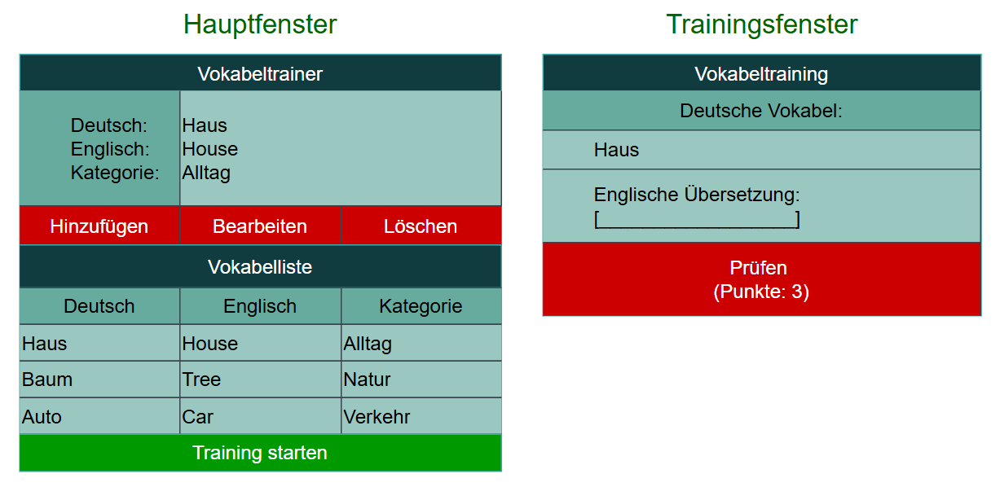

# Wireframe

## Hauptfenster

Das Hauptfenster dient zur Verwaltung der Vokabeln.

Der Benutzer kann neue Vokabeln hinzufügen, vorhandene Vokabeln bearbeiten und nicht mehr benötigte Vokabeln löschen. Alle gespeicherten Vokabeln werden in einer Tabelle übersichtlich angezeigt.

Über die Schaltfläche „Training starten“ kann das Trainingsfenster geöffnet werden.

## Trainingsfenster

Im Trainingsfenster wird dem Benutzer eine deutsche Vokabel angezeigt.

Der Benutzer gibt die passende englische Übersetzung ein und überprüft seine Eingabe über die Schaltfläche „Prüfen“.

Für jede richtige Antwort werden Punkte vergeben. Der aktuelle Punktestand wird während des Trainings angezeigt.