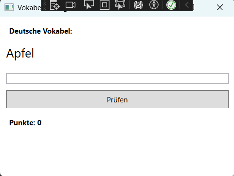

# Wireframe

## Hauptfenster

Das Hauptfenster dient zur Verwaltung der Vokabeln.

Der Benutzer kann neue Vokabeln hinzufügen, vorhandene Vokabeln bearbeiten und nicht mehr benötigte Vokabeln löschen. Alle gespeicherten Vokabeln werden in einer Tabelle übersichtlich angezeigt.

Über die Schaltfläche „Training starten“ kann das Trainingsfenster geöffnet werden.

## Trainingsfenster

Im Trainingsfenster wird dem Benutzer eine deutsche Vokabel angezeigt.

Der Benutzer gibt die passende englische Übersetzung ein und überprüft seine Eingabe über die Schaltfläche „Prüfen“.

Für jede richtige Antwort werden Punkte vergeben. Der aktuelle Punktestand wird während des Trainings angezeigt.

## Vergleich mit der fertigen Anwendung

Die im Wireframe geplanten Funktionen wurden in der finalen Anwendung umgesetzt.

### Umgesetzte Funktionen

- Vokabeln hinzufügen
- Vokabeln bearbeiten
- Vokabeln löschen
- Vokabeln in einer Tabelle anzeigen
- Vokabeltraining durchführen
- Punkte zählen
- Vokabeln im JSON-Format speichern
- Vokabeln aus einer JSON-Datei laden

### Ergebnis

Der ursprüngliche Entwurf konnte erfolgreich umgesetzt werden. Die Anwendung ermöglicht die Verwaltung deutscher und englischer Vokabeln sowie deren Abfrage im Trainingsmodus.

### Screenshot der fertigen Anwendung

