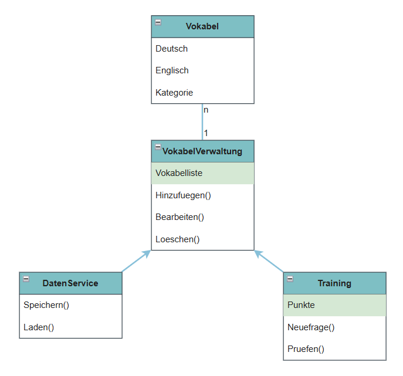

# UML-Klassendiagramm

Folgende Klassen wurden für das Projekt definiert:

- Vokabel
- VokabelVerwaltung
- DatenService
- Training

## Beziehungen

- Eine VokabelVerwaltung verwaltet mehrere Vokabeln (1:n).
- Der DatenService verwendet die VokabelVerwaltung zum Speichern und Laden von Vokabeldaten.
- Die Klasse Training verwendet die VokabelVerwaltung für den Zugriff auf die vorhandenen Vokabeln.

## Begründung

Die Klassen wurden nach dem Prinzip der klaren Verantwortlichkeiten entworfen.

- Die Klasse Vokabel speichert die Daten einer einzelnen Vokabel.
- Die Klasse VokabelVerwaltung verwaltet die gesamte Vokabelliste.
- Der DatenService ist für das Speichern und Laden der Daten verantwortlich.
- Die Klasse Training enthält die Logik des Vokabeltrainings.